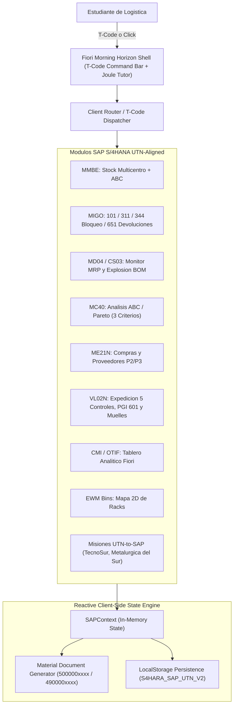
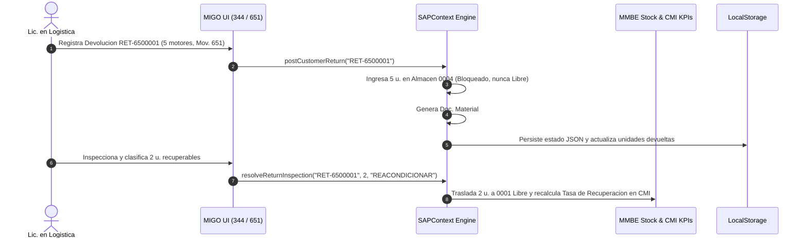

<div align="center">

# S4HARA — SAP S/4HANA Logistics Interactive Simulator

### *UTN FRBB Licenciatura en Logística → SAP S/4HANA Fiori Morning Horizon Edition*

[](https://www.typescriptlang.org/)
[](https://react.dev/)
[](https://tailwindcss.com/)
[](https://experience.sap.com/fiori-design-web/)
[](https://conventionalcommits.org)
[](https://github.com/nedder3/S4HARA)

</div>

---

## Executive Summary & Curriculum Alignment

**S4HARA** es un simulador operativo 100% client-side de **SAP S/4HANA Cloud (Logistics Management)** diseñado específicamente a partir de la currícula de la **Licenciatura en Logística (UTN FRBB)**. Traduce los trabajos prácticos, fórmulas y casos de negocio de la carrera directamente a las transacciones, movimientos y tableros analíticos que operan las empresas reales sobre SAP.

### Mapeo Currícula UTN → SAP S/4HANA

| Materia / Caso UTN | Transacción / App en S4HARA | Capacidad Operativa Simulada |
| :--- | :--- | :--- |
| **Planificación y Control (TP3 MRP)** | `MD04` / `CS03` | Proyección semanal (6 semanas), Requerimientos brutos/netos, Lead Time, Lote a Lote / Lote Fijo / EOQ, evaluación de costos y explosión BOM. |
| **Gestión de Abastecimiento I (TP2 ABC)** | `MC40` / `MMBE` | Análisis ABC / Curva de Pareto interactiva por 3 criterios (*Valor de Utilización*, *Valorizado de Inventario*, *Costo Unitario*). |
| **Crisis Logística TecnoSur (PL-IV)** | `MIGO 344` + `ME21N` + `MIGO 101` | Bloqueo preventivo de stock ante inundación (`Mov. 344`), evaluación de proveedores P2/P3 (confiabilidad y plazo) y recepción de emergencia (`Mov. 101`). |
| **Expedición y Muelles (PL-IV)** | `VL02N` + **EWM Dock** | Picking, checklist obligatorio de 5 controles de carga, PGI (`Mov. 601`) y dimensionamiento de muelles $N = \frac{Q_d T_d + Q_c T_c}{H \cdot 60 \cdot U}$ (compartidos vs exclusivos). |
| **Logística Inversa (Metalúrgica del Sur)** | `MIGO 651` | Recepción obligatoria de devoluciones en Almacén `0004` (Bloqueado), inspección técnica y clasificación de unidades recuperables. |
| **Gerenciamiento y Control de Gestión** | `CMI` / `OTIF` | Tablero Fiori Overview Page en tiempo real: Exactitud, Salidas a Tiempo, OTIF, Utilización de Muelle, Tasa de Devolución y Tasa de Recuperación. |

---

## Visual Architecture & Data Flow

### 1. System Architecture Flowchart (`flowchart TD`)



### 2. Transactional & Reverse Logistics Sequence (`sequenceDiagram`)



---

## Protocol & Data Schemas

### Documento de Material (`MaterialDocument`)

```json
{
  "docNumber": "5000004821",
  "postingDate": "2026-11-21",
  "docDate": "2026-11-21",
  "movementType": "344",
  "movementDescription": "Traspaso Libre Utilización a Stock Bloqueado (344)",
  "headerText": "Inundación Centro 1010 — Bloqueo preventivo auditoría TecnoSur",
  "createdBy": "FRANCO_LOG_UTN",
  "items": [
    {
      "itemNumber": 10,
      "materialId": "MAT-A100",
      "quantity": 17,
      "unit": "UN",
      "plantId": "1010",
      "storageLocationId": "0001",
      "batch": "LOT-TS-A1"
    }
  ]
}
```

---

## Reproducible Build Guide

### Requisitos
- Node.js $\ge$ 20.x
- npm $\ge$ 10.x

```bash
git clone git@github.com:nedder3/S4HARA.git
cd S4HARA
npm install
npm run dev
```

Compilación de producción:

```bash
npm run build
```
