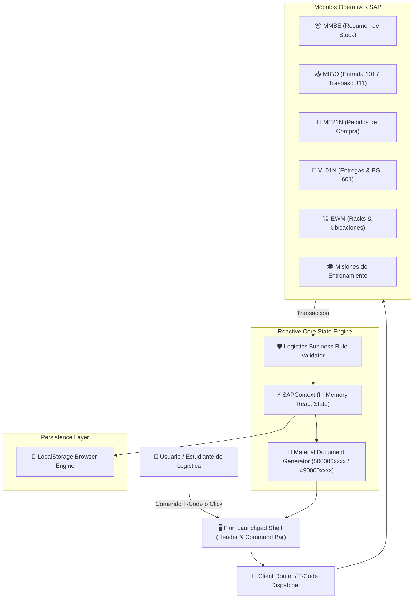
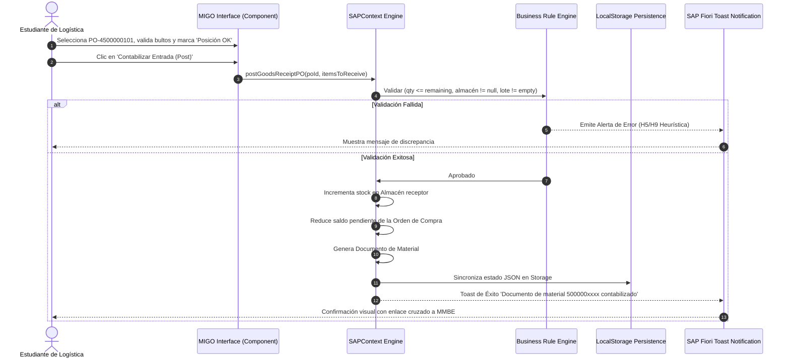

<div align="center">

# 📦 S4HARA — SAP S/4HANA Logistics Interactive Simulator

### *High-fidelity Client-Side SAP ERP Simulation Engine for Supply Chain & Logistics Training*

[](https://www.typescriptlang.org/)
[](https://react.dev/)
[](https://tailwindcss.com/)
[](https://experience.sap.com/fiori-design-web/)
[](https://conventionalcommits.org)
[](https://github.com/)

</div>

---

## 📋 Executive Summary & Capabilities

**S4HARA** es un simulador operativo interactivo de **SAP S/4HANA Cloud (Logistics Management Release 2026)** diseñado con fines educativos y de entrenamiento profesional para estudiantes y graduados de la **Licenciatura en Logística**.

El proyecto replica la experiencia operativa de un centro de distribución industrial real sin requerir costosas suscripciones de servidor, licencias SAP NetWeaver o configuraciones complejas de backend. Todo el motor corre de forma 100% reactiva en el cliente, persistiendo el estado en `localStorage` con aislamiento seguro de datos.

### Capacidades Destacadas

- **Doble Paradigma de Interfaz:** Interfaz moderna **SAP Fiori Horizon Launchpad** con barra de búsqueda global por códigos de transacción clásicos (`MMBE`, `MIGO`, `ME21N`, `VL01N`, `EWM`, `CASOS`).
- **Procure-to-Pay (P2P):** Recepción de camiones de proveedores contra pedidos de compra abiertos (PO), control de tolerancias, remitos y contabilización de Documentos de Material mediante movimiento `101`.
- **Gestión de Stock Multicentro (`MMBE`):** Desglose jerárquico de inventarios por Mandante $\rightarrow$ Centro (Planta 1010 / 1020) $\rightarrow$ Almacén (0001 General, 0002 Calidad, 0003 Expedición) $\rightarrow$ Lotes, con separación contable de Libre Utilización, Inspección y Bloqueado.
- **Traspasos Internos (`MIGO 311`):** Aislamiento de material no conforme a cuarentena en un solo paso.
- **Order-to-Cash (O2C) & Expedición (`VL01N / VL02N`):** Monitoreo de entregas salientes de clientes, ejecución de Picking y Contabilización de Salida de Mercancías (**PGI - Post Goods Issue / Movimiento 601**).
- **Visor 2D de Racks y Ubicaciones (EWM Lite):** Mapa interactivo de pasillos A, B, C y control de sobrecarga por estantería (`kg` vs capacidad estructural).
- **Misiones Guiadas para Entrevistas Laborales:** Casos de negocio reales con feedback paso a paso y consejos específicos para responder preguntas de reclutadores y líderes de logística.
- **Copiloto Joule AI Integrado:** Asistente conversacional con base de conocimiento técnico de logística en SAP.

---

## 🏛️ Visual Architecture & Data Flow

### 1. Ingestion & Transaction Data Flow (`flowchart TD`)



### 2. Concurrency & Transactional Handshake (`sequenceDiagram`)



---

## 🔌 Data Structures & Protocol Specifications

### Documento de Material (Material Document Schema)

Formato del payload generado al contabilizar cualquier movimiento (`MIGO` o `VL01N`):

```json
{
  "docNumber": "5000001201",
  "postingDate": "2026-11-05",
  "docDate": "2026-11-05",
  "movementType": "101",
  "movementDescription": "Entrada de mercancías para pedido en almacén (101)",
  "headerText": "Remito Prov. Ref: Plásticos Industriales Austral S.A.",
  "createdBy": "LIC_LOGISTICA",
  "items": [
    {
      "itemNumber": 10,
      "materialId": "MAT-1001",
      "quantity": 100,
      "unit": "PAL",
      "plantId": "1010",
      "storageLocationId": "0001",
      "batch": "LOT-2026-A1",
      "referenceDoc": "PO-4500000101"
    }
  ]
}
```

### Registro de Stock Multicentro (Stock Record Schema)

Estructura de inventario en tiempo real utilizada para el balance contable en `MMBE`:

```json
{
  "id": "1010-0001-MAT-1001-LOT-2026-A1",
  "plantId": "1010",
  "storageLocationId": "0001",
  "materialId": "MAT-1001",
  "batch": "LOT-2026-A1",
  "unrestricted": 320,
  "qualityInspection": 0,
  "blocked": 0,
  "inTransit": 0,
  "reserved": 40,
  "lastMovementDate": "2026-11-05"
}
```

---

## 🚀 Reproducible Runbook: Build, Run & Deploy

### Requisitos Previos

- **Node.js:** $\ge$ v20.x o v24.x
- **npm:** $\ge$ v10.x
- **Git:** $\ge$ v2.40+

### 1. Clonar el Repositorio

```bash
git clone https://github.com/user/s4hara.git
cd s4hara
```

### 2. Instalar Dependencias

```bash
npm install
```

### 3. Ejecutar Servidor de Desarrollo Local

```bash
npm run dev
```
Abre tu navegador en `http://localhost:5173`.

### 4. Compilar para Producción

```bash
npm run build
```
Los artefactos optimizados y listos para distribución se compilan en la carpeta `dist/`.

---

## 📜 Licencia y Propósito Educativo

Este software es un desarrollo independiente con propósitos formativos, didácticos y de entrenamiento para graduados en logística. No utiliza código fuente privativo ni binarios de SAP SE. Las marcas y nomenclaturas referenciadas pertenecen a sus respectivos titulares.
